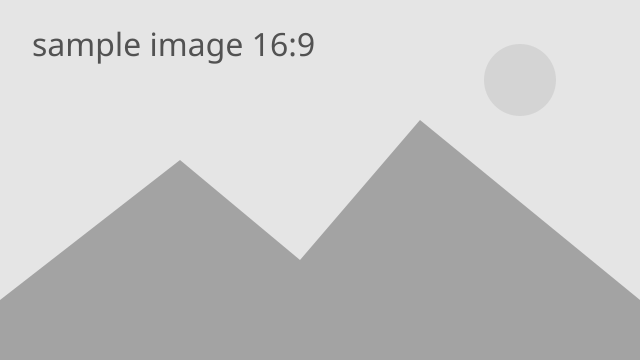

::title::

# Slidev Theme Micanis

::date::

Theme Preview

::default::

ミニマルな default と TUT の2つのバリアントを切り替えられるテーマ

---
layout: toc
label: Contents
hideInToc: true
---

::title::

# 目次

::default::

<Toc minDepth="1" maxDepth="2" />

---
layout: section
section: '01'
level: 1
---

# Slidevの基本

Markdownで書いて、ブラウザで発表します

---
layout: default
level: 2
---

::title::

# Slidevとは？（要約あり）

::default::

Slidevは、開発者向けに設計されたスライド作成・プレゼンテーションツールです。

- 📝 **Text-based** — Markdownで内容の作成に集中できます
- 🎨 **Themable** — テーマをパッケージとして共有・再利用できます
- 🧑‍💻 **Developer Friendly** — コード表示やライブコーディングに対応します
- 🤹 **Interactive** — Vueコンポーネントをスライド内で利用できます
- 📤 **Portable** — PDF、PPTX、PNG、Webアプリとして出力できます

::conc::

[Slidevについて詳しく見る](https://sli.dev/guide/why)

---
layout: default
level: 2
---

::title::

# ナビゲーション（要約なし）

::default::

画面左下へカーソルを移動すると、ナビゲーションコントロールが表示されます。

## キーボードショートカット

| キー | 操作 |
| --- | --- |
| <kbd>Space</kbd> / <kbd>Tab</kbd> / <kbd>→</kbd> | 次のアニメーションまたはスライド |
| <kbd>←</kbd> / <kbd>Shift</kbd> + <kbd>Space</kbd> | 前のアニメーションまたはスライド |
| <kbd>↑</kbd> | 前のスライド |
| <kbd>↓</kbd> | 次のスライド |

---
layout: default
title: コード
level: 2
---

シンタックスハイライト付きのコードをMarkdownへ直接記述できます。

```ts
interface User {
  id: number
  name: string
  role: string
}

function updateUser(user: User, update: Partial<User>) {
  return { ...user, ...update }
}
```

---
layout: section
section: '02'
level: 1
---

# テーマレイアウト

用途に合わせて情報を整理できます

---
layout: n-columns
columns: 3
gap: 24
title: Nカラムレイアウト（要約あり）
level: 2
---

### Text-based

Markdownを使って、内容を素早く記述できます。

::column-2::

### Themable

`columns` で任意のカラム数を指定できます。

::column-3::

### Portable

各セルは枠の内側に収まります。

::conc::

複数の観点を横並びで比較するときに適したレイアウトです。

---
layout: n-columns
columns: 2
gap: 24
title: Nカラムレイアウト（要約なし）
level: 2
---

### Content

要約が不要な場合は `conc` スロットを記述しません。

::column-2::

### Flexible

空いた高さはカラム領域がそのまま使用します。

---
layout: n-rows
rows: 3
gap: 16
title: Nロウレイアウト（要約あり）
level: 2
---

### 01 — Write

Markdownでスライドの内容を書く

::row-2::

### 02 — Present

ブラウザからプレゼンテーションを行う

::row-3::

### 03 — Export

必要な形式へスライドを書き出す

::conc::

処理や手順を上から順番に説明するときに適したレイアウトです。

---
layout: n-rows
rows: 2
gap: 16
title: Nロウレイアウト（要約なし）
level: 2
---

### 01 — Plan

構成と伝える内容を決める

::row-2::

### 02 — Build

スライドを作成して確認する

---
layout: n-columns
columns: 2
gap: 32
title: 画像とキャプション
level: 2
---



画像の直後の段落です。画像との間には余白が入ります。

<figcaption>図1: 列幅いっぱいの画像（2列）</figcaption>

::column-2::

### 画像の大きさの目安

- 2列: 約 510px（tut は約 560px）
- 3列: 約 340px（tut は約 370px）
- 高さを揃えるときは `h-48` などで指定

<small>出典: 例のための架空の画像</small>

---
layout: tut
level: 2
hideInToc: true
---

::title::

# tut レイアウト（表紙）

::date::

2026.10.20

::default::

cover と同じ構成の表紙です

---
layout: title
level: 2
---

# タイトルレイアウト

左寄せのタイトルページとして利用できます

---
layout: section
section: '03'
level: 1
---

# さらに詳しく

[ドキュメント](https://sli.dev) / [GitHub](https://github.com/slidevjs/slidev)
